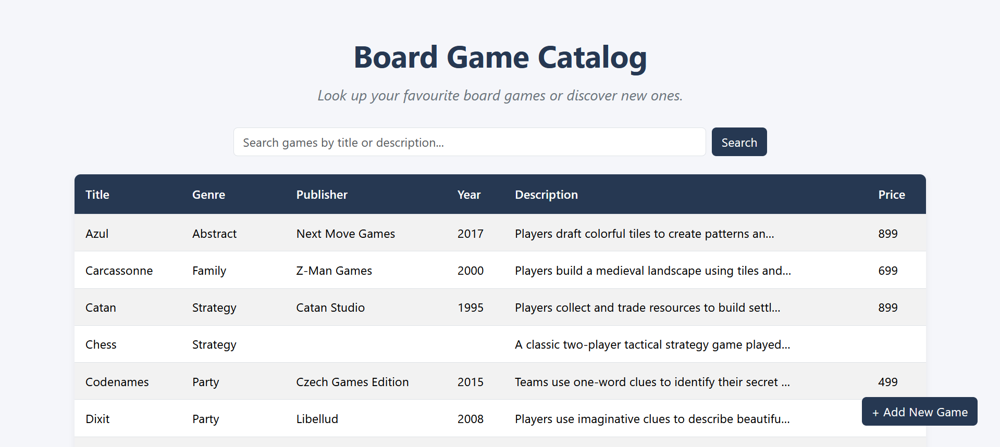
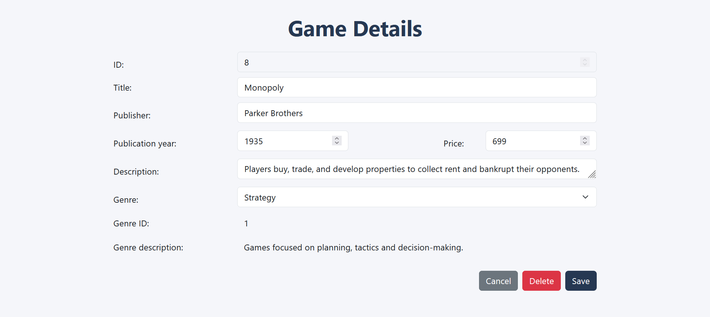

# Board Game Catalog



## 1. Student and project

- **Student ID:** A26352
- **Student name:** Tereza Musilová
- **Project title:** Board Game Catalog
- **Short description:** Web application for browsing, searching, adding, editing and deleting board games. The application also provides information about board game genres.

## 2. Technology stack

- **Backend:** Java 21, Spring Boot 4.1.2, Spring Data MongoDB, Gradle
- **Client:** React 19, Vite 8, React Router, Reactstrap and Bootstrap
- **Database:** MongoDB Atlas
- **API testing tool:** Thunder Client

## 3. Data model

The application uses MongoDB collections `games` and `genres`.

### Collection A: `games`

| Field | Type | Description |
|---|---|---|
| `_id` | String / ObjectId | MongoDB document ID |
| `id` | Integer | Custom game ID |
| `name` | String | Game title |
| `price` | Integer | Price |
| `publisher` | String | Publisher |
| `year` | Integer | Publication year |
| `description` | String | Game description |
| `genre_id` | Integer | ID of the related genre |

### Collection B: `genres`

| Field | Type | Description |
|---|---|---|
| `_id` | String / ObjectId | MongoDB document ID |
| `id` | Integer | Custom genre ID |
| `name` | String | Genre name |
| `description` | String | Genre description |

### Relationship

The common relationship field is `games.genre_id` and `genres.id`. A game belongs to one genre. The API and client use `genre_id` to find the matching genre by `id`.

## 4. Text index

- **Collection:** `games`
- **Indexed fields:** `name` and `description`
- **MongoDB index definition:**

```javascript
db.games.createIndex({ name: "text", description: "text" })
```

- **MongoDB text search query:** A MongoDB text search is represented as:

```javascript
{ $text: { $search: "<search phrase>" } }
```

- **API usage:** `GET /api/games/search?query=<text>` receives the `query` request parameter and creates a Spring Data MongoDB `TextCriteria` with `TextCriteria.forDefaultLanguage().matching(query)`. `TextQuery` executes the text search against the `games` collection through `MongoTemplate`, and the matching games are returned as JSON.

## 5. API endpoints

| Method | URL | Description |
|---|---|---|
| `GET` | `/api/games` | Get all games, sorted by name |
| `GET` | `/api/games/count` | Get the number of games |
| `GET` | `/api/games/{id}` | Get one game by its custom `id` |
| `GET` | `/api/games/search?query={text}` | Search games by text in title and description |
| `POST` | `/api/games` | Create a new game |
| `PUT` | `/api/games/{id}` | Update an existing game |
| `DELETE` | `/api/games/{id}` | Delete a game |
| `GET` | `/api/genres` | Get all genres, sorted by name |
| `GET` | `/api/genres/count` | Get the number of genres |
| `GET` | `/api/genres/{id}` | Get one genre by its custom `id` |

## 6. How to run

### 1. Import the data

Create a database named `boardgames` in MongoDB Atlas and import both JSON files. The JSON files can be imported in MongoDB Compass or with `mongoimport`:

```powershell
mongoimport --uri="<MongoDB connection URI>" --db=boardgames --collection=games --file=database/games.json --jsonArray
mongoimport --uri="<MongoDB connection URI>" --db=boardgames --collection=genres --file=database/genres.json --jsonArray
```

Create the text index in MongoDB Compass or in `mongosh`:

```javascript
use boardgames
db.games.createIndex({ name: "text", description: "text" })
```

### 2. Configure the backend

In PowerShell, set the MongoDB connection URI:

```powershell
$env:MONGODB_URI="<MongoDB connection URI>"
```

Copy the backend properties template:

```powershell
Copy-Item backend/src/main/resources/application.properties.example backend/src/main/resources/application.properties
```

Set `spring.application.name`, `spring.mongodb.database=boardgames`, and `server.port=8080` in `backend/src/main/resources/application.properties`. The URI is taken from the `MONGODB_URI` environment variable.

If required by your IDE, copy `backend/.env.example` to `backend/.env` and set `MONGODB_URI` there as well.

### 3. Install dependencies

The backend dependencies are managed by Gradle. From the repository root, run:

```powershell
cd backend
.\gradlew.bat test
```

Install the client dependencies:

```powershell
cd ../client
npm install
```

### 4. Start the backend

From the `backend` directory:

```powershell
.\gradlew.bat bootRun
```

The API runs at `http://localhost:8080`.

### 5. Start and open the client

In a second terminal, from the `client` directory:

```powershell
npm run dev
```

Open the URL displayed by Vite, normally `http://localhost:5173`. Vite proxies `/api` requests to `http://localhost:8080`.
